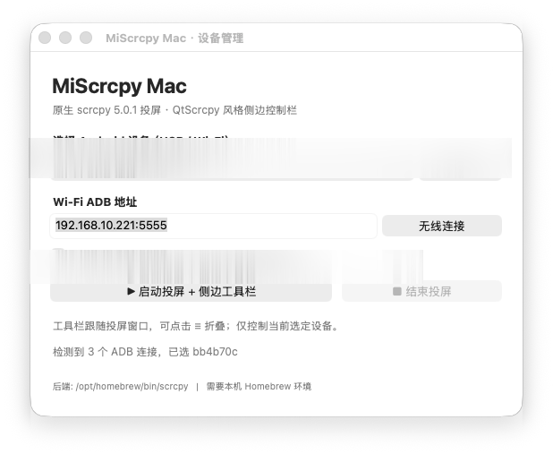
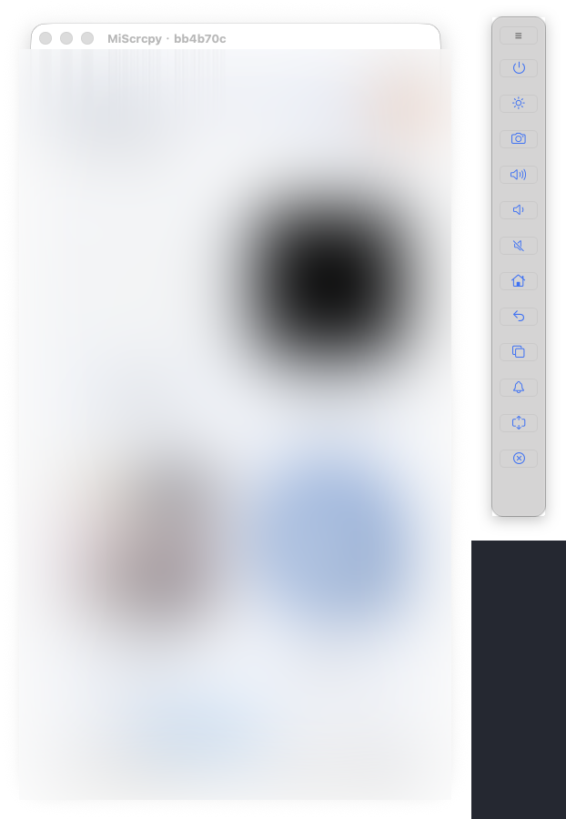

<div align="center">

# MiScrcpy Mac

**为 scrcpy 添加原生 macOS 设备管理界面与可折叠的侧边控制栏。**

A native macOS launcher and floating control toolbar for [scrcpy](https://github.com/Genymobile/scrcpy), inspired by [QtScrcpy](https://github.com/barry-ran/QtScrcpy).

  

</div>

## 📸 软件截图 / Screenshots

> 截图来自真实 Mac + Android 运行环境，设备识别信息和手机内容已模糊处理。

<table>
<tr>
<th>设备管理 · Device manager</th><th>远程窗口与侧栏 · Mirroring &amp; toolbar</th>
</tr>
<tr>
<td width="48%"></td>
<td width="52%"></td>
</tr>
</table>

## ✨ 功能 / Features

- **USB / Wi-Fi 连接选择：** 自动发现 ADB 已授权设备；可刷新列表、填写 IP 连接无线 ADB。
- **指定设备投屏：** 使用已安装的 `scrcpy 5.0.1`，通过 ADB 序列号选择手机，避免多机混淆。
- **可隐藏侧栏：** 原生 AppKit 悬浮工具栏跟随 scrcpy 投屏窗口，可点击 `≡` 折叠/展开。
- **快捷控制：** 手机屏幕电源与唤醒、音量加/减、静音、Home、返回、最近任务、通知栏、关闭投屏。
- **远程截图：** 通过 ADB 保存到 `~/Pictures/MiScrcpyMac/<device>/`。
- **关闭手机实体屏幕：** 可选择在开始投屏时使用 `--turn-screen-off`，电脑画面不受影响。
- **菜单栏快捷入口：** 可从 macOS 菜单栏重新打开管理界面。

视频由官方 scrcpy 窗口负责渲染；本项目并非直接修改 QtScrcpy 源代码，而是独立实现 macOS UI 与控制菜单。

## ⬇️ 下载 / Download

**[MiScrcpy Mac v0.1.0 DMG](dist/MiScrcpy-Mac-0.1.0.dmg)**

本版本是开发者预览版，安装包采用 **ad-hoc 本地签名，未经过 Apple 公证**。DMG 仅包含 Mac 前端，**不捆绑 scrcpy 或 adb**，请先安装依赖：

```bash
brew install scrcpy
brew install --cask android-platform-tools
scrcpy --version
adb version
```

双击 DMG，把 `MiScrcpy Mac.app` 拖入 `Applications`。首次打开如果遇到 Gatekeeper 提示，可以右键选择「打开」，并按 macOS 提示允许。

**测试环境：** Mac mini M2 / Apple Silicon、macOS 26.x、scrcpy 5.0.1、小米 3W（LineageOS 18.1 / Android 11）。其他机型与系统版本尚未全面验证。

## 🚀 快速开始 / Quick Start

1. Android 打开开发者选项和 USB 调试，连接 Mac，并在手机上确认授权。
2. 打开 MiScrcpy Mac，点击「刷新」，选择列表中的 USB 或 Wi-Fi 设备。
3. 点击「启动投屏 + 侧边工具栏」，等待 scrcpy 远程窗口出现。
4. 点击侧栏顶部 `≡` 可隐藏或展开菜单；用侧栏按钮控制手机。
5. 使用 Wi-Fi 时，先确保手机已启用 ADB TCP/IP 连接，输入 `手机IP:5555`，点击「无线连接」，再选择对应设备。

可在终端确认 ADB 状态：

```bash
adb devices -l
adb connect 192.168.1.100:5555   # 仅为示例，请替换为真实设备 IP
```

同一部手机同时通过 USB 和 Wi-Fi 连接时，会有两条记录；选择哪条记录，就通过那条连接启动投屏。

## 🛠️ 源码与构建 / Build from source

原生 Objective-C + AppKit + CoreGraphics 实现，构建需要 Xcode（或完整的 Xcode Command Line Tools）：

```bash
git clone https://github.com/samni728/myscrcpy.git
cd myscrcpy
chmod +x scripts/build.sh
./scripts/build.sh
```

生成文件：

| 文件 | 说明 |
| --- | --- |
| `Sources/main.m` | 原生应用、ADB 设备管理、scrcpy 进程和浮动侧栏 |
| `scripts/build.sh` | 编译、ad-hoc 签名和 DMG 打包 |
| `Build/MiScrcpy Mac.app` | 本机编译的 App（已忽略，不提交 Git） |
| `dist/MiScrcpy-Mac-0.1.0.dmg` | 可下载 DMG |

## 🧪 验证和限制 / Tested & Limitations

| 项目 | 当前状态 |
| --- | --- |
| Mac App 编译、运行及 DMG 校验 | ✅ 已验证 |
| 小米 3 USB / Wi-Fi 启动投屏 | ✅ 已验证 |
| 侧栏跟随窗口、折叠/展开 | ✅ 已验证 |
| USB 截图、Wi-Fi ADB 截图 | ✅ 已验证底层操作 |
| 各侧栏按钮逐个人工点击回归 | 尚未全部完成 |
| 长时间连续投屏与更多机型 | 待测试 |
| 内置录屏、音频转发、离线全依赖安装 | 暂未支持 |

- **全屏**：在 scrcpy 投屏窗口使用 `Cmd+F`。当前侧栏全屏按钮提供快捷键提示。
- **手机熄屏**：侧栏电源按钮会发送 Android 电源键。如希望手机实体屏幕关闭但电脑继续投屏，请使用启动界面的「启动时关闭手机实体屏幕」。
- **录屏**：旧设备使用 scrcpy 录制时曾出现崩溃，因此 0.1.0 没有内置录屏功能。
- **依赖**：目前只搜索本机 `/opt/homebrew/bin` 或 `/usr/local/bin` 下的 `scrcpy`、`adb`。
- **安全**：应用不会修改手机 root、ROM、Magisk 或 Google Photos 备份配置。

## 🙏 致谢 / Credits

感谢 [Genymobile/scrcpy](https://github.com/Genymobile/scrcpy) 提供投屏核心，以及 [QtScrcpy](https://github.com/barry-ran/QtScrcpy) 提供交互设计参考。上游软件各自适用其许可条款；**本仓库目前尚未另行指定源码许可**。

---

**English:** MiScrcpy Mac is a lightweight AppKit frontend for scrcpy 5.0.1. It supports Android device selection over USB/TCP-IP ADB, a collapsible floating control bar, device key events, screen-off on start and screenshots. It is an early preview; the DMG requires host-installed scrcpy/ADB and is not notarized.
